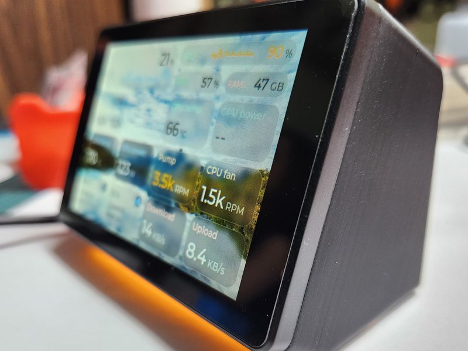
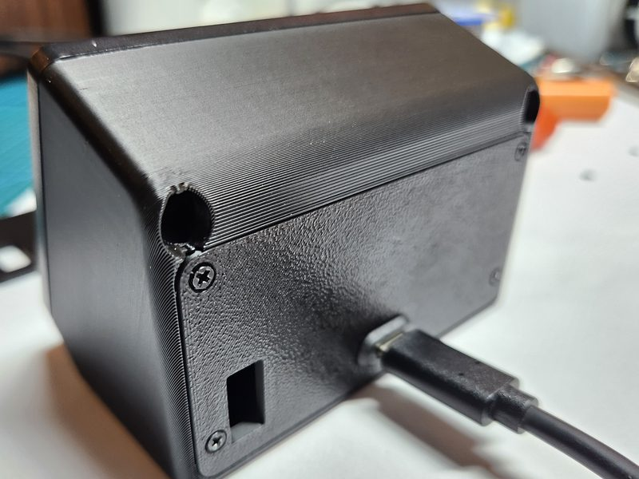
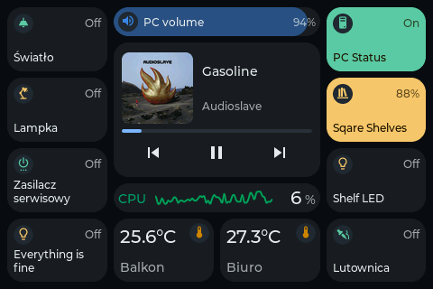
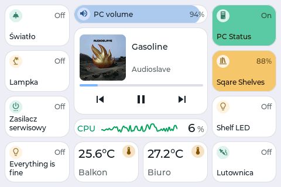
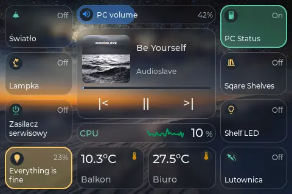
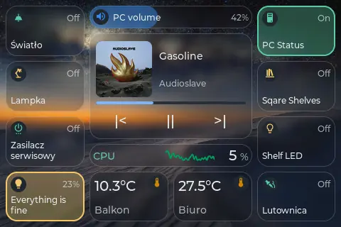
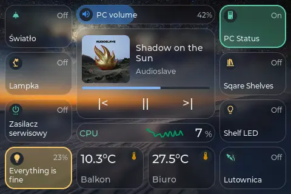
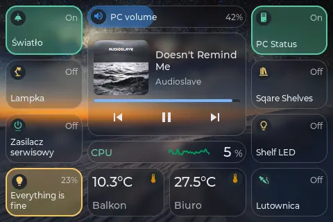
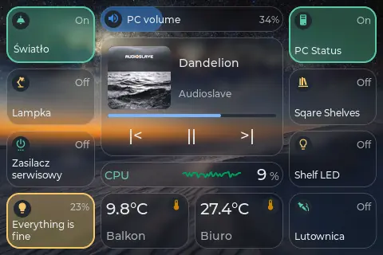
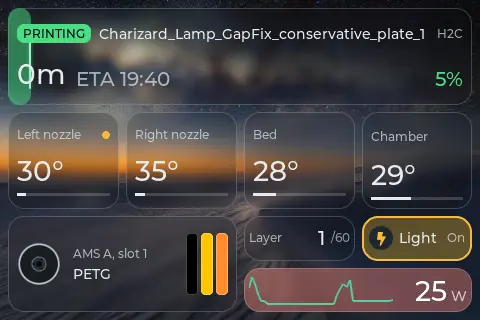

# TouchDeck

A touch control deck for the Guition JC3248W535 (3.5" 320x480 IPS, capacitive touch, ESP32-S3 with 16 MB flash and 8 MB PSRAM). Pages of tiles switch and read Home Assistant entities, show live PC stats from the TouchDeck Companion and follow Bambu Lab printers. Everything is set up from a web portal on the device. No cloud, no accounts: it talks to Home Assistant over its local WebSocket API and receives PC metrics over UDP on the LAN.

> A personal project built around my own desk setup, shared as is. Expect features that only make sense for that setup, and rough edges.

**Install from the browser:** [touchdeck.stolaris.dev](https://touchdeck.stolaris.dev) flashes the latest release over USB from desktop Chrome or Edge, sets up WiFi in the same tab and walks through Home Assistant and the PC companion.

**Full feature guide:** [GUIDE.md](GUIDE.md).

## Hardware

Guition JC3248W535: AXS15231B panel over QSPI, AXS15231B touch on I2C. Nothing to wire. 3D printed case: [MakerWorld model 3463113](https://makerworld.com/models/3463113).

| | |
|:---:|:---:|
|  |  |

Optional: a single-colour status LED on a free GPIO ([Status LED](GUIDE.md#status-led)) and a microSD card for wallpapers and brand icons.

## Screenshots

Short video of the deck in use: [YouTube](https://youtube.com/shorts/eh1_8pJR3-M).

Captured from the device (`/screen.bmp`), Glass theme unless noted.

| | |
|:---:|:---:|
|  |  |
| Home Assistant tiles, media and PC volume | PC stats from the companion |
|  |  |
| Midnight theme | Daylight theme |
|  |  |
| Bambu Lab printer page | AMS units and all slots |
|  |  |
| Home lab: Proxmox and pfSense | Quick panel |

## Animations

Recorded frame by frame from the display. Pick a set under **Display > Animations** (Classic, Calm, Water, Glass, Heavy, or Custom to choose each effect).

| | |
|:---:|:---:|
|  |  |
| Calm | Water |
|  |  |
| Glass | Heavy |
|  |  |
| Photo frame | Printer animations |

## What it does

- **Pages of tiles** up to 6x4, sized in half-cell steps, stacked into columns: swipe sideways between columns, up and down within one. [More](GUIDE.md#pages-and-tiles)
- **Home Assistant:** switches, sliders, scenes and scripts, sensors with history charts and warning thresholds, a detail card on long press. Material Design Icons, plus optional [brand icons](GUIDE.md#brand-icons).
- **PC stats and control** from the [TouchDeck Companion](GUIDE.md#pc-stats-and-control-touchdeck-companion) (Windows, Linux): metric tiles, media keys, volume, now playing, hotkeys, sleep and shut down.
- **Bambu Lab printers:** up to two, over the LAN or through Home Assistant, with printer and AMS pages. [More](GUIDE.md#bambu-lab-printers)
- **HTTP buttons and sensors** for LAN devices without Home Assistant (Tasmota, Node-RED, your own projects). [Buttons](GUIDE.md#http-buttons), [sensors](GUIDE.md#http-sensors)
- **Conditional tiles and pages:** shown only while a PC is on or off, or while an entity is in a state. [More](GUIDE.md#conditional-tiles)
- **Themes:** Midnight, Daylight and Glass over your own pictures or daily Windows Spotlight wallpapers, per-tile colours and icon styles. [Wallpapers](GUIDE.md#wallpapers-and-microsd)
- **Screen sleep** on Home Assistant presence, night schedules for the backlight and the status LED. [More](GUIDE.md#screen-sleep)
- **MQTT discovery:** the deck shows up in Home Assistant with its screen, page, night mode and a message toast. [More](GUIDE.md#mqtt-home-assistant-discovery)
- **Edit on the device:** long press an empty spot to move, resize, add or remove tiles. A quick panel from the top edge has brightness, night mode and link status.

## Getting started

1. Flash from [touchdeck.stolaris.dev](https://touchdeck.stolaris.dev), or see [Flashing without the web flasher](GUIDE.md#flashing-without-the-web-flasher).
2. Set up WiFi over USB in the same tab, or join the deck's **`TouchDeck-XXXX`** network (password `touchdeck1234`, setup page at `http://192.168.4.1`).
3. Open the device IP, connect [Home Assistant](GUIDE.md#home-assistant) and build your pages.

Updating a deck that already runs TouchDeck: upload `TouchDeck-<version>-ota.bin` from [Releases](https://github.com/Keralots/TouchDeck/releases) in **Maintenance > Firmware update**. Building from source: [GUIDE.md](GUIDE.md#building-from-source).

## Credits

Built on [LVGL](https://lvgl.io/), [ArduinoJson](https://github.com/bblanchon/ArduinoJson), [arduinoWebSockets](https://github.com/Links2004/arduinoWebSockets), [GFX Library for Arduino](https://github.com/moononournation/Arduino_GFX) (AXS15231B init table) and [Improv WiFi](https://www.improv-wifi.com/) (vendored under `lib/ImprovWiFi`). Fonts: Montserrat (SIL OFL 1.1) with the LVGL symbol set (Font Awesome Free); icons: Material Design Icons, installed on the device by the user.

## License

MIT, see [LICENSE](LICENSE). The vendored Improv WiFi library keeps its own MIT license in `lib/ImprovWiFi/LICENSE`.
