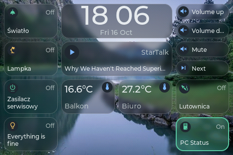
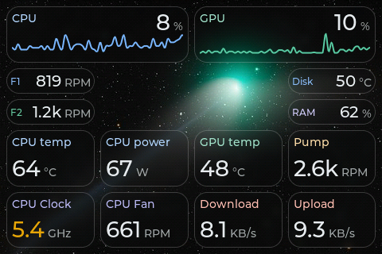
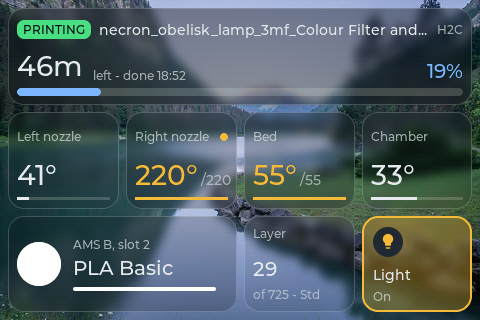
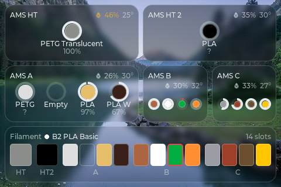
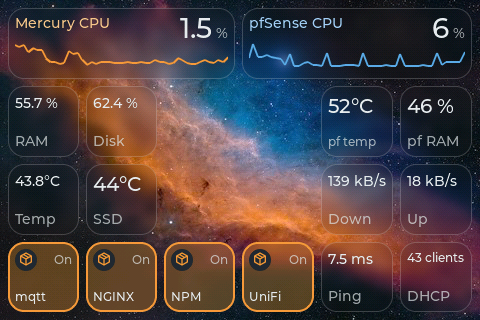
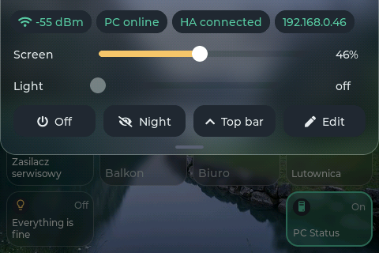

# TouchDeck

> TouchDeck is a personal project, built around my own desk setup: Home Assistant, Bambu Lab printers, a PC companion app and a few custom actions. It is not meant as a general-purpose product, but it is shared as is in case parts of it are useful to someone else. Expect features that only make sense for that setup, and rough edges.

A touch control deck for the Guition JC3248W535 (3.5" 320x480 IPS, capacitive touch, ESP32-S3 with 16 MB flash and 8 MB PSRAM). Pages of tiles switch and read Home Assistant entities and show live PC stats from the TouchDeck Companion. Everything is set up from a web portal on the device.

No cloud, no accounts: the device talks to Home Assistant over its local WebSocket API and receives PC metrics over UDP on the LAN.

## Screenshots

Captured from the device (`/screen.bmp`) with the Glass theme.

| | |
|:---:|:---:|
|  |  |
| Home Assistant tiles, clock and media | PC stats from the companion |
|  |  |
| Bambu Lab printer page | AMS units and all slots |
|  |  |
| Home lab: Proxmox and pfSense | Quick panel |

## What it does

- **Pages of tiles** in a grid (up to 6x4 per page): switches, buttons and sensors from Home Assistant, and PC metric tiles (number, chart or bar). Tiles are placed and sized in half-cell steps (1x1.5, 1.5x1, 0.5x0.5...); text and icons scale with the tile, so small tiles shrink instead of overlapping.
- **Columns:** pages stacked into a column. Swipe left and right between columns, up and down between the pages of a column.
- **Home Assistant:** live state over the WebSocket API, optimistic toggles, scenes / scripts / buttons, a detail card on long press with a level slider (light brightness, cover position, fan speed, volume, numbers). Icons come from Material Design Icons, the set Home Assistant uses (the font is installed from the portal).
- **Sensor history:** `style: "chart"` and `hours` (1..168, default 24) show Home Assistant history; the detail card includes min / max / now. Optional `warn` and `crit` thresholds colour the value and line amber or red; `crit` below `warn` makes lower values worse, such as battery levels. `"format": "duration"` shows a reading in s, min, h or d as `1h 49m` or `3d 2h` (uptime, time left on a print, a battery runtime).
- **Slider tiles:** a light, cover, fan, media player or number as a tile that fills to its level; drag sideways on it to change the level (the page does not swipe there), tap to toggle, hold for the card. Pick "Slider" as the tile type in the portal.
- **Confirm before acting:** a tile can ask on the device before it turns something off (a printer mid-print) or before every action. Set it under the tile's "more options" button in the portal.
- **Conditional tiles:** a tile can show only while the PC is on, only while it is off, or only while a Home Assistant entity is (or is not) in a given state. Its cell stays free otherwise, so a tile with the opposite condition can share it: volume buttons while the PC runs, a "PC power" switch in the same place while it is off. See [Conditional tiles](#conditional-tiles).
- **Tile colours:** per tile, the icon, text, off background and on fill colours, and in Glass its own glass and on opacity, all optional on top of the theme ("more options" in Pages & tiles).
- **HTTP buttons:** a button can send an HTTP request to a device on the LAN (Tasmota, Node-RED, your own projects) instead of calling Home Assistant.
- **PC stats:** metric tiles fed by the TouchDeck Companion; values, units, history chart and an amber warning colour above a set share of the scale.
- **Quick panel:** pull down from the top edge for screen and LED brightness, link status, screen off, night mode, the top bar switch and the page editor.
- **Edit on the device:** long press an empty spot of a page (or Edit in the quick panel) to move (swap works as in the portal), resize or remove its tiles, or add one with + (a list of Home Assistant entities by group, from the list cached with "Update from HA" in the portal); Done saves the page.
- **Night schedules** for the backlight and, separately, an optional status / filament LED on a PWM pin. The LED's day brightness can follow a Home Assistant input_boolean, input_number or light, and the quick panel's Light slider sets that entity.
- **System screens** for start-up, WiFi setup (with a QR code to join the setup network), connecting, and a firmware update screen with progress.

## Web portal

Open the device IP (or `http://<hostname>.local`) in a browser:

- **Overview:** live picture of the screen, PC stream, Home Assistant link, diagnostics.
- **Pages & tiles:** Home Assistant address and token, the icon font, pages, tiles, entity and icon pickers (None leaves a tile without an icon), columns, and a grid editor: drag tiles to move them (dropped onto another tile, that tile jumps to the dragged one's old place if it fits there), resize from the corner (half-cell steps), separately for landscape and portrait.
- **Display:** rotation, theme (Midnight, Daylight, or Glass: tinted glass tiles over a wallpaper you upload), brightness, night schedule, PC metric tile scales.
- **Time:** 12/24 h clock and timezone.
- **Hardware:** the status LED.
- **Network:** WiFi, hostname / mDNS, static IP.
- **Advanced:** optional features, off by default: Bambu Lab printers.
- **Maintenance:** configuration backup (pages and settings; WiFi and the Home Assistant token are never included), firmware update, factory reset.

## Home Assistant

In **Pages & tiles**, enter the Home Assistant address (for example `http://192.168.0.7:8123`) and a long-lived access token (HA profile, Security tab). The token is stored only on the device. Then add tiles from the entity picker.

## Conditional tiles

In **Pages & tiles**, a tile's "more options" has "Show": Always, Only while the PC is on, Only while the PC is off, or Only while an entity is (or is not) in a state. A tile whose condition does not hold takes no cell, and the page is laid out again when a condition changes (once nothing is being touched). When a page has conditional tiles, "Preview" above the grid switches each condition so you can place the tiles for both cases.

```json
{ "id": "vol", "type": "action", "when": "pc-on",
  "tap": { "action": "pc", "cmd": "volume_up" },
  "pos": { "landscape": { "x": 3, "y": 0 } } },
{ "id": "pcpow", "type": "toggle", "entity": "switch.pc_power",
  "when": { "entity": "switch.pc_power", "state": "!on" },
  "pos": { "landscape": { "x": 3, "y": 0 } } }
```

- `"pc-on"` / `"pc-off"` follow the tile's own PC (the PC of its command or metric, otherwise the first known PC). The PC counts as off about a minute after its companion stops sending, so a companion restart does not rearrange the page; it counts as on again with the first packet.
- `{ "entity": ..., "state": ... }` compares the state Home Assistant reports (`on`, `off`, `home`, `playing`...); a leading `!` means "is not". The tile stays hidden until Home Assistant has reported the entity; while Home Assistant is unreachable the last known state stands.

A whole page can follow a condition the same way ("Page shown" in the page settings; its PC is the first known one). With "Switch to it when it appears" (`"auto": true`) the deck slides to the page when the condition starts to hold, for example a PC stats page when the PC comes on, and back to the page shown before when it stops:

```json
{ "id": "pcstats", "name": "PC", "when": "pc-on", "auto": true, "tiles": [ ... ] }
```

A page that goes away while it is shown always hands over to another page first; a slide waits until nothing is being touched and no card is open.

## HTTP buttons

A button tile can send an HTTP request instead of calling Home Assistant, for devices and services on the LAN that take commands over plain http (Tasmota, Node-RED, your own ESP projects). In **Pages & tiles**, use "+ Add HTTP button", or open a button's "more options" and set "On tap" to "HTTP request". Fill in the method, URL and optionally a body and headers; "Test" sends the request from the device and shows the answer. On the device a tap shows a short toast: "OK" for a 2xx answer, otherwise the status code or why it failed.

Example, toggling a Tasmota relay ([Tasmota docs](https://tasmota.github.io/docs/Commands/), spaces as `%20`):

```json
{ "id": "plug", "type": "action", "label": "Plug", "icon": "mdi:power",
  "confirm": "always",
  "tap": { "action": "http", "url": "http://192.168.0.50/cm?cmnd=Power%20Toggle" } }
```

The full action: `"method"` (GET, POST, PUT, PATCH, DELETE; GET by default, POST when there is a body), `"url"` (http only, no https), `"body"` (text, or a JSON object), `"contentType"` (automatic: a body starting with `{` or `[` is sent as application/json, other text as text/plain) and `"headers"` (`{ "Name": "value" }`). The request lives in the deck configuration, which anyone on your network can read through the portal, so keep important passwords out of it.

## HTTP sensors

Use "+ Add HTTP sensor" to poll a LAN JSON endpoint and show one value. Test fetches the reply from the device; click a JSON leaf to select its path. For example, a UPS endpoint returning `{"ups":{"load":18,"runtime_min":95}}`:

```json
{ "type": "sensor", "label": "UPS load", "icon": "mdi:battery-charging",
  "http": { "url": "http://192.168.0.10:8080/status",
            "path": "ups.load", "poll": 60 },
  "unit": "%", "style": "chart", "warn": 70, "crit": 90,
  "detail": "runtime {ups.runtime_min|min}" }
```

`http.url` uses plain http and GET only. `http.path` selects dot-separated keys; numeric segments index arrays (`items.0.value`). An empty path reads a bare number or string. `http.poll` is seconds, 5..3600, default 30. Optional `http.headers` is a `{"Name":"value"}` object, with the same visibility as HTTP button headers. Tasmota's `http://<ip>/cm?cmnd=<command>` URL form is another possible source; choose a path from that command's actual reply.

Optional `unit` is appended only to JSON numbers, formatted with at most one decimal. Strings display as received, booleans as On/Off. `style` is `number` or `chart`; charts keep the last 48 numeric readings since boot. `warn` and `crit` use the same numeric thresholds as HA sensors, including lower-is-worse. Tiles sharing a URL and headers share one request at their shortest poll interval. A missing path shows `--`; failed first polls or replies older than three poll intervals show `--` at half opacity. Polling runs only with WiFi, with a 32 KB response limit. Tiles are read-only by default; explicit `tap` and `hold` actions still work, without a default HA card.

`"format": "duration"` reads `unit` as the input unit (s, min, h, d) and shows the number as `1h 49m` instead.

`detail` adds a small line under the name, built from the same reply: `{path}` inserts a value, `{path|min}` shows a number of minutes as a duration (also `s`, `h`, `d`), anything else is literal text, for example `"{StatusSNS.ENERGY.Voltage} V  {StatusSNS.ENERGY.Current} A"`. In the portal, Test shows "+ Detail" next to each value. The line gives way on tiles too small for it.

`rows` shows up to four values from the same reply under the name, one line each with a label, a bar and the value, instead of one big reading. The bar spans 0..`scaleMax` (default 100) and is left out when the tile is too narrow for it. `unit`, `format`, `warn` and `crit` apply to every row; `http.path` and `style` are ignored. For example, Claude usage from a local endpoint:

```json
{ "type": "sensor", "label": "Claude", "icon": "mdi:robot",
  "http": { "url": "http://192.168.0.10:8760/usage", "poll": 60 },
  "unit": "%", "warn": 70, "crit": 90,
  "rows": [ { "label": "5h:", "path": "claude.five_hour.used" },
            { "label": "W:", "path": "claude.weekly.used" } ] }
```

A row's optional `value` is a template like `detail`: the bar still follows `path`, the text shows the template, and the row falls back to the plain reading when the bar would not fit beside it. `{path}` fields also work in the tile's `label`. For example, a 1x1 tile named "Claude 18%" with the time to each reset next to the usage bars:

```json
{ "type": "sensor", "label": "Claude {claude.five_hour.used}%", "icon": "none",
  "http": { "url": "http://192.168.0.10:8760/usage", "poll": 60 },
  "unit": "%", "warn": 70, "crit": 90,
  "rows": [ { "label": "5h:", "path": "claude.five_hour.used",
              "value": "{claude.five_hour.reset_min|min}" },
            { "label": "W:", "path": "claude.weekly.used",
              "value": "{claude.weekly.reset_min|min}" } ] }
```

The portal keeps `rows` when a tile is edited but has no editor for them yet; add them in the JSON.

## Bambu Lab printers

Up to two Bambu Lab printers report to the deck over the LAN (MQTT over TLS, port 8883), so the printer needs LAN mode or LAN access turned on. Printers are off by default: turn them on under **Advanced**. Turned off again, the deck drops the printer connections and hides printer pages and tiles, but keeps their setup. In **Pages & tiles**, "Printers": add the printer's IP address, then store its serial number and LAN access code (both stay on the device and are never shown again). "Create printer page" adds a page with progress and time left on top, the nozzle, bed and chamber temperatures, the filament in use, the layer and the chamber light. An AMS page is stacked below it, with one tile per unit and an all-slots strip when a row is free.

A printer can have a plug: a Home Assistant switch that powers it. The printer then connects only while the plug is on, and pages set to "Only while ... is on" appear with it; with the plug off the deck holds no connection, buffers or pages for it. Without a plug the printer is always tried.

```json
"printers": [{ "id": "h2c", "name": "H2C", "ip": "192.168.0.54",
               "plug": "switch.printer_plug" }]
```

A page with `"printer": "h2c"` follows that printer. A printer tile is `{ "type": "printer", "printer": "h2c", "show": "hero" }`; `show` is `hero`, `nozzle` (with `"nozzle": "left"` on dual nozzle printers), `bed`, `chamber`, `filament`, `layer` or `light` (a tap switches the chamber light). The tiles sit on the page grid like any other tile. Three more views are available:

- `ams` with `"unit": 1` shows one AMS unit, its humidity, temperature and spools. The unit is its 1-based position in the printer's reported list (1..6), default
  1. Use 2x1 for a four-slot AMS or 1x1 for an AMS HT.
- `slots` shows every unit's slots in one colour strip, best at 4x1 or 2x1.
- `summary` shows compact status, progress and time left on a normal page, best at 2x1. A tap opens the printer's first page when it is available; the tile shows Off while its printer is not powered.

## PC stats and control: TouchDeck Companion

The companion runs on the PC, reads the sensors and pushes a JSON packet to UDP port `4210` of the device every second. It lives in [`TouchDeck-CompanionApp/`](TouchDeck-CompanionApp/) (forked from the StatNode companion; it runs side by side with the StatNode, SmallOLED and AnimatedPixelClock companions).

- **Windows:** reads [LibreHardwareMonitor](https://github.com/LibreHardwareMonitor/LibreHardwareMonitor), which must be running (as administrator for full coverage), with its remote web server enabled (port `8085`) or through WMI.
- **Linux:** reads the sensors directly.

The companion UI opens at `http://127.0.0.1:8750`; point it at the device IP. The PC and the device must share a subnet with UDP `4210` reachable. Add metric tiles in **Pages & tiles** with "+ Add PC metric".

- **Several PCs:** each companion sends its own id and name (Connection page, "This PC's name"); the device keeps up to four PCs and a metric tile picks one.
- **Control:** on the companion's Device page, click "Pair for control", then tap Allow on the device. If the device ever loses the pairing (a full flash erase), the companion notices and the device asks Allow again by itself; Deny stops those prompts until the companion restarts. Older companions still pair with a code shown on the device. Tiles made with "+ Add PC control" then send media keys, volume, lock, sleep, restart or shut down to that PC (Sleep, Restart and Shut down ask on the device first). Commands are signed with the key from pairing and arrive on UDP `4211` (allow it in the firewall).
- **Volume slider:** "+ Add PC volume" adds a slider for the PC's master volume: drag sideways to set it, tap to mute. In deck.json: `{ "type": "slider", "control": "pc-volume" }` (optional `"pc"`). The companion receives it as `volume_set:N` (Windows through the audio endpoint, Linux through `pactl`).
- **Now playing:** "+ Add now playing" adds a 2x2 tile with cover art, title, artist, progress and previous/play/next controls. Smaller tiles show the track and tap to play or pause. Use the companion from this version. Covers travel over TCP port `8751` on the PC (or an available port if busy), so allow the companion through the firewall. Covers require WiFi transport; playback controls also work over USB.
- **Hotkeys:** the command "Hotkey" sends a key combination such as `ctrl+shift+m` (up to five keys: ctrl, shift, alt, win, a-z, 0-9, f1-f24 and named keys like enter, esc or pageup) to the PC's focused window, handy for app shortcuts bound to F13-F24. In deck.json: `{ "action": "pc", "cmd": "hotkey", "keys": "ctrl+shift+m" }`. Windows does not let it reach a window running as administrator unless the companion runs as administrator too. On Linux it uses `xdotool`, so X11 only.
- **USB cable:** when the device is plugged into the PC, the companion finds it (Espressif USB serial, 303A:1001) and sends metrics and commands over the cable instead of WiFi. While it holds the port, USB flashing and the serial monitor cannot open it: use OTA, or set "USB cable" to Off.

## Hardware

Guition JC3248W535: AXS15231B panel over QSPI, AXS15231B touch on I2C. Nothing to wire for the panel or touch.

Optional status LED: a plain single-colour LED driven through a transistor from a free GPIO (default 17 on the extended IO header). Pins used by the display, touch, USB, flash or PSRAM are refused by the portal.

## Flashing a prebuilt binary

[Releases](https://github.com/Keralots/TouchDeck/releases) ship two firmware files: `TouchDeck-<version>-full.bin` (full image, for a first flash over USB) and `TouchDeck-<version>-ota.bin` (app only, for **Maintenance > Firmware update** in the portal of a device that already runs TouchDeck). The Windows companion is attached as `TouchDeckCompanion-<version>.exe`.

**Web flasher (esptool-js):**
1. Visit the [ESP Web Flasher](https://espressif.github.io/esptool-js/) in desktop **Chrome or Edge** (Web Serial is required, so Firefox, Safari and mobile won't work).
2. Connect the board via USB. If it constantly connects/disconnects, hold the **BOOT** button, connect to USB while still holding it, then release after connecting. Alternatively, hold **BOOT**, press **RESET** while holding **BOOT**, then release both buttons.
3. Close the TouchDeck Companion if it runs on this PC: it holds the device's serial port.
4. Click **"Connect"** and select your port.
5. Click **"Choose File"** and select the full image, e.g. `TouchDeck-v1.0.0-full.bin`.
6. Set **Flash Address** to `0x0`.
7. Click **"Program"** and wait until it finishes.
8. Done! Continue with [First-run setup](#first-run-setup).

**Manual:**
`esptool.py --chip esp32s3 --port COM3 --baud 460800 write_flash 0x0 TouchDeck-v1.0.0-full.bin`

## Build and flash

Built with [PlatformIO](https://platformio.org/), one environment:

```sh
pio run                       # build
pio run -t upload             # flash over USB
curl -F "firmware=@.pio/build/jc3248w535/firmware.bin" http://<device-ip>/ota/upload
python create_firmware.py     # full and OTA images in release/<version>/
```

The full image is flashed at `0x0` (esptool or the [ESP web flasher](https://espressif.github.io/esptool-js/) in Chrome or Edge); the OTA image is uploaded in **Maintenance > Firmware update**.

## First-run setup

1. Flash the firmware and power the device.
2. It opens the WiFi network **`TouchDeck-XXXX`** (password `touchdeck1234`); scan the QR code on the screen or join it by hand, and the setup page opens at `http://192.168.4.1`. (Improv over USB serial also works for the first 3 minutes.)
3. Once it is on your network, open the device IP, connect Home Assistant and build your pages.

## Credits

Built on [LVGL](https://lvgl.io/), [ArduinoJson](https://github.com/bblanchon/ArduinoJson), [arduinoWebSockets](https://github.com/Links2004/arduinoWebSockets), [GFX Library for Arduino](https://github.com/moononournation/Arduino_GFX) (AXS15231B init table) and [Improv WiFi](https://www.improv-wifi.com/) (vendored under `lib/ImprovWiFi`). Fonts: Montserrat (SIL OFL 1.1) with the LVGL symbol set (Font Awesome Free); icons: Material Design Icons, installed on the device by the user.

## License

MIT, see [LICENSE](LICENSE). The vendored Improv WiFi library keeps its own MIT license in `lib/ImprovWiFi/LICENSE`.
